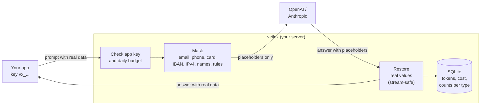

# veilox

**Keep customer data out of AI providers and know what every AI call costs.**

[](https://github.com/jsxd3v/veilox/actions/workflows/ci.yml)
[](https://goreportcard.com/report/github.com/jsxd3v/veilox)
[](https://github.com/jsxd3v/veilox/releases)
[](LICENSE)


veilox is a small self-hosted gateway that sits between your app and OpenAI or Anthropic. It swaps personal
data for placeholders before the prompt leaves your server, puts the real values back into the answer
(streams too), and records what each call cost, per app. Your app changes its base URL and key. Nothing else.

## Example: one request, step by step

**1. Your app's request.** This is [`examples/data.json`](examples/data.json), a normal OpenAI Chat Completions
body:

```json
{
  "model": "gpt-6.1-terra",
  "messages": [
    { "role": "system", "content": "You are a polite support agent. Write a short reply." },
    { "role": "user", "content": "Hi, I am Maria Santos (maria.santos@example.com, +351 912 345 678). My card 4111 1111 1111 1111 was charged twice. Please help." }
  ]
}
```

**2. Check what veilox would hide** (a dry run: nothing is sent anywhere):

```text
$ veilox scan --request examples/data.json --config examples/veilox.yaml
...
4 values would be masked (dry run: nothing was sent anywhere):

TYPE         PLACEHOLDER      VALUE
NAME         <NAME_1>         Maria Santos
EMAIL        <EMAIL_1>        maria.santos@example.com
PHONE        <PHONE_1>        +351 912 345 678
CREDIT_CARD  <CREDIT_CARD_1>  4111 1111 1111 1111
```

**3. Send it through veilox.** Same request, sent to veilox instead of OpenAI, with the app's veilox key:

```bash
curl -s localhost:8080/v1/chat/completions -H "Authorization: Bearer vx_..." -d @examples/data.json
```

The provider receives only placeholders:

```text
Hi, I am <NAME_1> (<EMAIL_1>, <PHONE_1>). My card <CREDIT_CARD_1> was charged twice. Please help.
```

The model answers with placeholders too, and veilox puts the real values back before your app sees the
answer:

```json
"content": "Hi Maria Santos, sorry about the double charge on card 4111 1111 1111 1111. The refund is on its way and we'll confirm it at maria.santos@example.com."
```

The link between `<NAME_1>` and `Maria Santos` exists only in memory, for this one request. It's never
written to disk or to the logs.

**4. See what it cost.** Each request is recorded with its tokens, cost and how many values were hidden
(counts only, never the values):

```text
$ veilox report --by app,model
APP          MODEL          REQUESTS  ERRORS  INPUT TOK  OUTPUT TOK    COST  MASKED
support-bot  gpt-6.1-terra         1       0         38          32  <$0.01       4
TOTAL                              1       0         38          32  <$0.01       4
```

To try steps 3 and 4 without an API key, run the fake provider
([`examples/fake-provider`](examples/fake-provider)), which answers like a model and prints everything it
receives. The [quick start](#quick-start-under-a-minute) below sets up the rest.

## Quick start (under a minute)

**1. Get veilox.**

| You use | Install |
|---|---|
| macOS / Linux | Download from [Releases](https://github.com/jsxd3v/veilox/releases), or `go install github.com/jsxd3v/veilox/cmd/veilox@latest` (Go 1.26+) |
| Windows | `veilox_<version>_windows_amd64.zip` from [Releases](https://github.com/jsxd3v/veilox/releases) |
| Docker | `ghcr.io/jsxd3v/veilox` (see [Docker](#docker) below) |

**2. Create a key for your app and get the example config.**

```bash
veilox keygen support-bot          # prints the app's key and the hash for veilox.yaml
curl -fsSLO https://raw.githubusercontent.com/jsxd3v/veilox/main/examples/veilox.yaml
curl -fsSLO https://raw.githubusercontent.com/jsxd3v/veilox/main/examples/prices.yaml
curl -fsSLO https://raw.githubusercontent.com/jsxd3v/veilox/main/examples/names.txt
```

Paste the `key_sha256` line into `veilox.yaml`, and edit `prices.yaml` (the shipped numbers are examples).

**3. Run it.**

```bash
export OPENAI_API_KEY=sk-...        # and/or ANTHROPIC_API_KEY
veilox check                        # validates the config and tells you what's missing
veilox serve
```

**4. Point your app at it.**

```python
# OpenAI SDK
client = OpenAI(base_url="http://localhost:8080/v1", api_key="vx_...")

# Anthropic SDK
client = Anthropic(base_url="http://localhost:8080", api_key="vx_...")
```

The same works from Node, Go, PHP or anything that lets you set a base URL. Streaming works as before.

Want to see what would be masked before you route traffic? `veilox scan ticket.txt` is a dry run on any
file, and `veilox scan --request data.json` shows a request exactly as the provider would receive it.

## How it works



- **Same value, same placeholder** within a request, so the model can still tell that two mentions are the
  same person.
- **Streaming:** a placeholder can arrive split across chunks (`<NA` + `ME_1>`). veilox holds back the few
  characters that could be the start of one, so your app never sees half a placeholder.
  [How streaming works](docs/streaming.md).
- **Tool calls:** values in tool arguments come back JSON-escaped, so the arguments stay valid JSON.
- **Fail closed:** if veilox can't parse a request, it doesn't forward it.
- **Budgets:** an app over its daily budget gets a `429` in the format its SDK expects, with `Retry-After`.

## What gets masked

| Type | Example | How it's found |
|---|---|---|
| `EMAIL` | `maria.santos@example.com` | Pattern |
| `PHONE` | `+351 912 345 678`, `(555) 010-4477` | Pattern; needs a `+` or separators, so order numbers aren't phones |
| `CREDIT_CARD` | `4111 1111 1111 1111` | Pattern + Luhn checksum |
| `IBAN` | `DE89 3704 0044 0532 0130 00` | Pattern + mod-97 checksum + length per country |
| `IPV4` | `203.0.113.7` | Valid dotted quad, not version strings |
| `NAME` | `Maria Santos` | **Only names you list** in the config |
| your own | `CUS-004211` | Your regex rules |

Detection is deterministic: same input, same config, same output, and every detector is covered by table
tests with near-misses (bad checksums, dates, order numbers, versions). The exact rules and how overlaps
are resolved: [docs/detectors.md](docs/detectors.md).

## Configuration

`veilox.yaml`, the parts you'll touch:

```yaml
providers:
  openai:    { base_url: https://api.openai.com,    api_key_env: OPENAI_API_KEY }
  anthropic: { base_url: https://api.anthropic.com, api_key_env: ANTHROPIC_API_KEY }

apps:
  - name: support-bot
    key_sha256: 3b1f...             # from `veilox keygen support-bot`
    daily_budget_usd: 5

masking:
  names_file: names.txt             # one name per line, e.g. from your CRM export
  rules:
    - { name: CUSTOMER_ID, pattern: 'CUS-[0-9]{6}' }
  unsupported_content: forward      # or reject: refuse images/files, which can't be masked

storage:
  path: ./data/veilox.db
  retention_days: 90
```

| Setting | Default | |
|---|---|---|
| `server.listen` | `:8080` | Or `VEILOX_LISTEN` |
| `server.max_body_bytes` | `10485760` | Larger requests get `413` |
| `server.upstream_timeout` | `10m` | The whole provider call, streams included |
| `server.timezone` | `UTC` | When a budget day starts |
| `providers.openai.base_url` | `https://api.openai.com` | Any OpenAI-compatible API works (OpenRouter, Groq, vLLM, Ollama…) |
| `apps[].daily_budget_usd` | none | Soft limit: a request that starts under budget may finish over it |
| `masking.detectors` | all five | `email, phone, credit_card, iban, ipv4` |
| `masking.ipv4.skip_private` | `false` | Leave 10.x, 192.168.x, … unmasked |
| `masking.system_hint` | `false` | Ask the model in one line to keep placeholders exactly |
| `storage.path` | `./data/veilox.db` | Or `VEILOX_DB` |
| `pricing.file` | `./prices.yaml` | USD per million tokens per model |
| `pricing.unknown_model` | `allow` | `reject` refuses models missing from the price table |
| `log.format` | `json` | `json` or `text` |

**Prices:** `prices.yaml` ships with **example values. Check your provider's current pricing** and edit the
file. veilox doesn't fetch prices. Models missing from it are still proxied and marked `*` in reports.

App keys are stored as SHA-256 hashes, so `veilox.yaml` can go in Git. Provider keys stay in veilox's
environment. `SIGHUP` reloads the config and prices without a restart.

Full reference: [docs/configuration.md](docs/configuration.md).

## Commands

| Command | |
|---|---|
| `veilox serve` | Run the gateway. `SIGHUP` reloads, `SIGTERM` waits for open requests |
| `veilox report` | Spend by day, app, model or provider. `--since 7d`, `--app`, `--by`, `--format table\|csv\|json` |
| `veilox scan <file\|->` | Dry run: what would be masked. `--request` reads an API request body, `--json` for scripts |
| `veilox keygen <app>` | New app key and the hash for the config |
| `veilox check` | Validate `veilox.yaml` and `prices.yaml`, warn about missing provider keys |

## Docker

```bash
docker run -d -p 8080:8080 \
  -v "$PWD:/etc/veilox:ro" -v veilox-data:/data \
  -e OPENAI_API_KEY -e ANTHROPIC_API_KEY \
  ghcr.io/jsxd3v/veilox
```

The image reads `/etc/veilox/veilox.yaml` and keeps its database in `/data`. It is distroless, runs as a
non-root user and works with a read-only root filesystem. A Compose example sits in
[`examples/docker-compose.yml`](examples/docker-compose.yml).

## What veilox does NOT protect against

Please read this before you rely on it.

- **Names it doesn't know.** Without ML, veilox only masks names on your list. "My neighbour Jo Bloggs
  called" goes through as written. Regex can't recognise every name, and veilox doesn't pretend to.
- **Personal data without a fixed format:** street addresses, dates of birth, health details, national ID
  numbers (unless you add a rule), values spelled out ("maria at example dot com") or misspelled.
- **Images, PDFs, audio and files** inside requests. They're forwarded unchanged, or refused with
  `unsupported_content: reject`.
- **Context.** "The CEO of a Lisbon bakery chain" identifies someone without containing any of the above.
- **A model that rewrites placeholders** (`<Name_1>`, `NAME_1`). Those aren't restored. `system_hint: true`
  helps. Anthropic thinking text keeps its placeholders: thinking blocks are signed and must stay unchanged.
- **Endpoints other than** `/v1/chat/completions` and `/v1/messages`. Embeddings, the OpenAI Responses API,
  batch and file uploads aren't proxied in 0.1.
- **Network exposure.** veilox serves plain HTTP. Run it on a private network or behind TLS (Caddy, Nginx, a
  load balancer).

veilox reduces what leaves your server. It doesn't replace a data processing agreement with your provider.

## Quality

- Every detector has table tests with matches and near-misses, plus fuzz tests and a speed test on
  worst-case input.
- Stream restoring is tested at every split point of sample texts and fuzzed against the non-streaming
  result.
- Integration tests run the gateway against a fake OpenAI and Anthropic (JSON, SSE, tool calls, errors,
  budgets, disconnects) and **fail if a known value reaches the provider, the logs or the database file**.
- CI: golangci-lint (incl. gosec), `go test -race` on Linux, macOS and Windows, coverage gate at 80% (about
  95% today), govulncheck, cross-compiles and a Docker smoke test. No real API calls.

## Roadmap

- Web dashboard for spend, masked counts and budgets
- Optional ML name and address detection (local, opt-in)
- Gemini, the OpenAI Responses API, embeddings
- Budgets shared across instances, monthly budgets, alerts at 80% / 100%
- Prometheus metrics
- More detectors with checksums: national IDs, tax numbers

Ideas and pull requests are welcome: [CONTRIBUTING.md](CONTRIBUTING.md).

## Development

```bash
go test -race ./...              # no API keys needed: tests use a fake provider
golangci-lint run
go build ./cmd/veilox
```

```
cmd/veilox/          CLI entry point
internal/detect/     detectors and overlap rules
internal/mask/       per-request mapping, restore, stream restorer
internal/proxy/      HTTP server, OpenAI and Anthropic adapters, SSE
internal/store/      SQLite: request rows and reports
internal/…           config, pricing, budget, auth, cli
```

Security issues: see [SECURITY.md](SECURITY.md).

## License

[Apache-2.0](LICENSE). Copyright 2026 jsxd3v.
