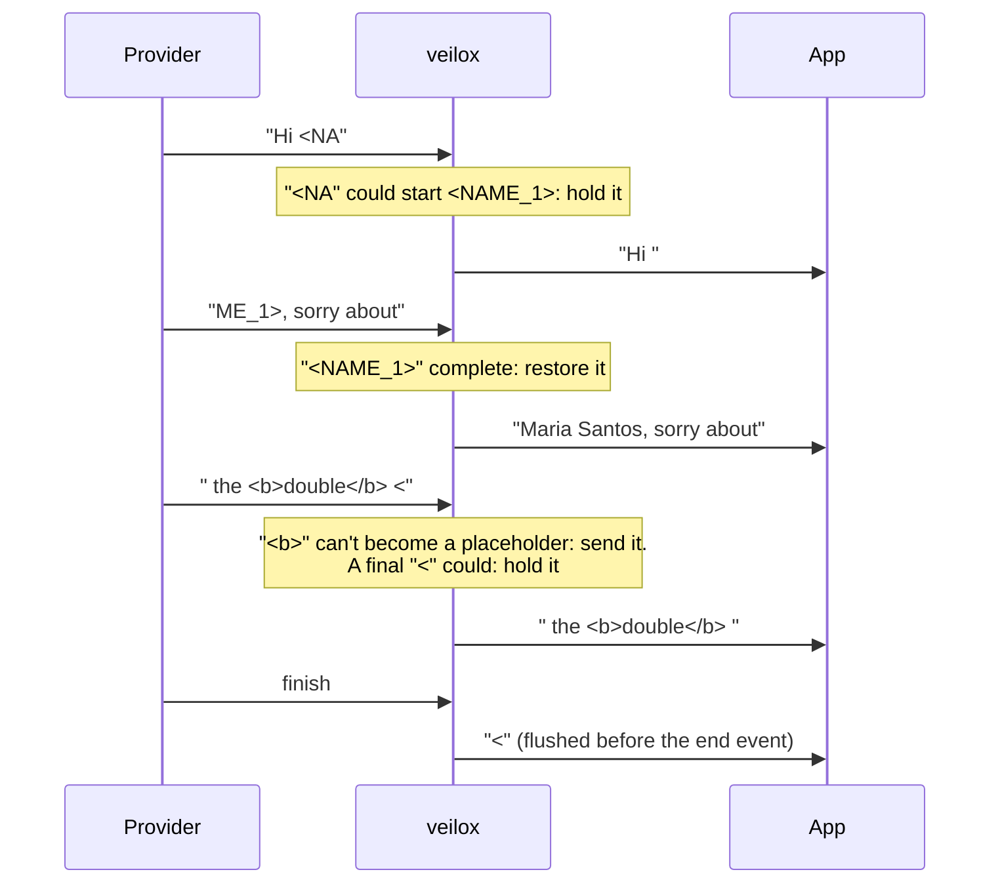

# Streaming

With `"stream": true`, the provider sends its answer as server-sent events, a few characters at a time.
veilox reads the stream event by event, puts the real values back, and passes each event on straight
away. Nothing waits for the whole answer.

## Placeholders split across chunks

A model writes `<NAME_1>` as several tokens, so the stream can deliver it in pieces:

```text
event 1:  "Hi <NA"
event 2:  "ME_1>, sorry about"
```

If veilox restored each event on its own, neither piece would match, and your app would show
`Hi <NAME_1>`. So for every text stream veilox keeps a small hold-back buffer:



The rules:

- Only placeholders **issued for this request** are held. Other text with `<` (HTML, code, `a < b`)
  is released as soon as it can't grow into one of them.
- Held text is at most one placeholder long, so the delay is a few characters.
- At the end of a text stream (OpenAI `finish_reason`, Anthropic `content_block_stop`, `[DONE]`, or the
  connection closing), anything still held is sent in one extra delta event **before** the end event.
- Your app receives exactly the same final text as it would without streaming. A fuzz test checks this
  for random chunk boundaries, and a second test tries every split point of sample texts.

Each text stream has its own buffer: per choice and per tool call for OpenAI, per content block for
Anthropic.

## Tool calls

Tool arguments arrive as streamed JSON text (`function.arguments` for OpenAI, `partial_json` for
Anthropic). In those streams veilox:

- inserts values **JSON-escaped**, so a name like `Ann "Q" O'Neill` doesn't break the arguments;
- also recognises placeholders written with escaped brackets (`<EMAIL_1>`), which some
  providers produce.

## What passes through unchanged

Events that carry no text (`ping`, `message_start`, role chunks, comments, `[DONE]`) are written back
byte for byte. Events with text are re-encoded with the restored text; field order may differ, the
content doesn't.

Anthropic `thinking` deltas are **not** restored. Thinking blocks are signed, and your app has to send
them back unchanged in the next turn. So thinking text shows placeholders.

## Token usage

- **OpenAI:** usage only arrives in a stream if the request sets `stream_options.include_usage`. veilox
  sets it, and if your app didn't ask for it, removes the extra usage chunk again. Your app sees exactly
  the stream it asked for.
- **Anthropic:** input tokens come from `message_start`, output tokens from the last `message_delta`.

## When the app disconnects

If your app closes the connection mid-stream, veilox cancels the provider request, records the request
with status `499` and whatever usage arrived so far, and frees the mapping. Partial streams may have
consumed tokens that the provider never reported, so their cost can be under-counted.
