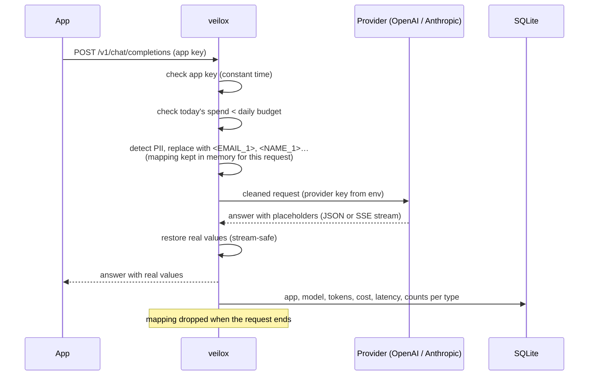

# veilox: Project Specification

> **Keep customer data out of AI providers and know what every AI call costs.**

| | |
|---|---|
| Status | v0.1 implemented (this document matches the code) |
| Date | 2026-11-09 |
| Repository | https://github.com/jsxd3v/veilox |
| License | Apache-2.0 |
| Language | Go 1.26+ (standard library first). The pure-Go SQLite driver needs 1.26; Go supports its two newest releases (1.26, 1.27) |
| Distribution | Single binary (macOS, Linux, Windows; amd64 + arm64) via GitHub Releases, Docker image `ghcr.io/jsxd3v/veilox` |
| Works with | Any app that talks to OpenAI-compatible Chat Completions or the Anthropic Messages API, in any language |

### Naming

| Where | Name |
|---|---|
| GitHub repo | `jsxd3v/veilox` |
| Command | `veilox` |
| Go module | `github.com/jsxd3v/veilox` |
| Docker image | `ghcr.io/jsxd3v/veilox` |
| Config file | `veilox.yaml` (path via `--config` or `VEILOX_CONFIG`) |
| Price table | `prices.yaml` |
| Database | `veilox.db` (SQLite, path in config) |
| Environment variables | `VEILOX_*` for veilox itself; provider keys keep their usual names (`OPENAI_API_KEY`, `ANTHROPIC_API_KEY`) |
| App keys | `vx_` + 40 random base62 characters |

---

## 1. Problem

Teams add AI features by sending customer text (support tickets, emails, CRM notes, chat logs) straight to a
model provider. Two things go wrong:

1. **Personal data leaves the company.** Names, emails, phone numbers, card numbers and IBANs end up in a
   third party's logs. Legal and security reviews block or slow down the feature, or nobody asks and it ships
   anyway.
2. **Nobody knows what it costs.** One provider bill per month, no split per feature or app, and a runaway
   loop can spend a month's budget in an afternoon.

Existing options:

| Option | Gap |
|---|---|
| Mask in each app by hand | Every team re-implements it, differently, and forgets the response side and streaming |
| LLM gateways (LiteLLM, Portkey, Helicone…) | Strong at routing and cost tracking. PII masking is usually a plugin, a paid tier, or one-way (redact only, no restore), and the stack is heavier (Python, Postgres, Redis, a UI) |
| Cloud DLP services | Another external service that sees the data, priced per request, and it doesn't restore values into the model's answer |

**veilox's angle:** one small Go binary next to your app. It masks before the data leaves, **restores the real
values into the answer (including streams)** so the app works unchanged, and tracks cost and budgets per app.
No database server, no UI, no ML model, no outbound calls except to the provider.

## 2. Goals and non-goals for 0.1

**Goals**

- Drop-in: the app changes only its base URL and API key. Official OpenAI and Anthropic SDKs work as-is,
  streaming included.
- Deterministic masking: same input + same config → same output, every time. Every detector unit-tested.
- Round trip: placeholders in the model's answer are replaced with the real values, also when a placeholder is
  split across stream chunks.
- No real values at rest: the mapping lives in memory for one request only. Logs and the database hold counts
  per type, never values.
- Cost per request in SQLite, daily budgets per app with a clear `429`.
- Fail closed: if veilox can't parse or mask a request, it does not forward it.

**Out of scope for 0.1 (see Roadmap, section 13)**

Web dashboard, ML/NER name detection, Gemini, OpenAI Responses API, embeddings, images/audio/files masking,
multi-instance shared budgets.

## 3. How it works



## 4. Proxy API

### 4.1 Endpoints

| Method + path | Upstream | Notes |
|---|---|---|
| `POST /v1/chat/completions` | `{providers.openai.base_url}/v1/chat/completions` | OpenAI and OpenAI-compatible APIs (OpenRouter, Groq, Together, vLLM…) |
| `POST /v1/messages` | `{providers.anthropic.base_url}/v1/messages` | Anthropic Messages API |
| `GET /healthz` | – | `200 ok`, no auth, no details |
| anything else | – | `404` with a message naming the two supported endpoints |

SDK setup:

| SDK | Base URL | API key |
|---|---|---|
| OpenAI (`openai` Python/Node, etc.) | `http://localhost:8080/v1` | the app's `vx_…` key |
| Anthropic (`anthropic` Python/Node, etc.) | `http://localhost:8080` | the app's `vx_…` key |

### 4.2 Authentication

- Apps send their veilox key as `Authorization: Bearer vx_…` (OpenAI SDKs) or `x-api-key: vx_…` (Anthropic
  SDKs). Both are accepted on both endpoints.
- The config stores only the **SHA-256 of each key** (`key_sha256`), so `veilox.yaml` can be committed.
  `veilox keygen <app>` prints a new key and its hash.
- Lookup: hash the presented key, compare against **every** app's hash with `crypto/subtle.ConstantTimeCompare`,
  no early exit.
- The app's key is removed; veilox sets the provider key from its own environment (`Authorization: Bearer` for
  OpenAI, `x-api-key` for Anthropic). Provider keys never appear in config, logs or responses.

### 4.3 Request handling

1. Size limit: body over `server.max_body_bytes` (default 10 MiB) → `413`.
2. Auth → `401` if unknown.
3. Budget → `429` if today's spend ≥ `daily_budget_usd` (section 8).
4. Parse JSON. Invalid JSON → `400`, nothing forwarded.
5. Mask the text fields listed in 4.4. Every other field is forwarded unchanged.
6. For OpenAI streaming requests without `stream_options.include_usage`, veilox adds it (to get token counts)
   and drops the extra usage-only chunk before it reaches the app, so the app sees exactly what it asked for.
7. Forward. Headers passed through: `Content-Type`, `Accept`, `anthropic-version`, `anthropic-beta`,
   `OpenAI-Organization`, `OpenAI-Project`, `User-Agent`. Hop-by-hop and auth headers are dropped.
   `Accept-Encoding` is not forwarded (veilox must read the body to restore it).
8. Restore placeholders in the response (4.5), copy status and safe headers, stream if streaming.
9. Record usage (section 7).

Every response carries `X-Veilox-Request-Id` (random, also in the log line) for support.

### 4.4 What gets masked

| API | Fields |
|---|---|
| OpenAI | `messages[].content` (string, or `text` parts of an array), `messages[].tool_calls[].function.arguments`, `messages[].name` is **not** masked (an identifier) |
| Anthropic | `system` (string or `text` blocks), `messages[].content` (string, `text` blocks, `tool_result` content text, `tool_use.input` string values) |

Non-text parts (images, audio, files, documents) **cannot be masked**. `masking.unsupported_content`:

- `forward` (default): forwarded unchanged, counted as `unmasked_parts` in the log.
- `reject`: request refused with `400` explaining which part type.

The **same value maps to the same placeholder** everywhere in one request (all messages, system prompt and tool
arguments), so the model can still see that two mentions are the same person.

### 4.5 Restoring values

- Only placeholders **issued for this request** are replaced. Anything else that looks like a placeholder is
  left alone.
- Places restored: OpenAI `choices[].message.content`, `choices[].message.tool_calls[].function.arguments`;
  Anthropic `content[].text`, `content[].input` (string values, recursively). Same fields in stream deltas.
- Inside JSON text that the app will parse (tool-call `arguments`, Anthropic `partial_json`), the value is
  inserted JSON-escaped, so a name containing `"` doesn't break the arguments. There, placeholders written
  with escaped brackets (`\u003cEMAIL_1\u003e`, as Go and some providers emit) are recognised too.
- Anthropic `thinking` text is not restored: thinking blocks are signed and must go back unchanged.
- Error responses from the provider are restored the same way before they're returned.

### 4.6 Streaming (SSE)

veilox reads the upstream stream event by event and rewrites each event's text before flushing it to the app.

**Split placeholders.** A placeholder can arrive in pieces: `"Hi <NA"`, `"ME_1>, your order"`. Per text stream
(OpenAI: per choice index and per tool-call index; Anthropic: per content block index) veilox keeps a small
**hold-back buffer**:

- If the text ends with something that could still become one of the placeholders **issued for this
  request** (`<`, `<N`, `<NAME_`, `<NAME_1` …; in JSON text also `\u003cNAME_`…), that tail is held back.
  Complete placeholders before it are restored.
- The held text is prepended to the next delta of the same stream.
- If the tail can no longer become a placeholder (e.g. `<b>`), it is released right away.
- At the end of a stream (OpenAI `finish_reason`, Anthropic `content_block_stop`, upstream EOF or error) the
  buffer is flushed into an extra delta event emitted just before the end event.

Result: the app receives exactly the same final text as the non-streaming restore would produce, with at most
a few characters of delay. This is checked by a fuzz test (section 11).

Other stream details:

- Events other than text deltas (`ping`, `message_start`, role chunks…) pass through byte-for-byte.
- `data: [DONE]` passes through.
- Each event is flushed immediately (`http.Flusher`). No buffering of the whole stream.
- If the app disconnects, the upstream request is cancelled and the request is recorded with
  `status=client_closed` and whatever usage was received.

### 4.7 Errors

Errors veilox produces itself use the **shape of the API that was called**, so SDKs surface them normally:

```json
// OpenAI endpoint
{"error": {"message": "veilox: daily budget of $5.00 for app \"support-bot\" reached; resets at 00:00 UTC", "type": "budget_exceeded", "code": "veilox_budget_exceeded"}}
// Anthropic endpoint
{"type": "error", "error": {"type": "rate_limit_error", "message": "veilox: daily budget of $5.00 for app \"support-bot\" reached; resets at 00:00 UTC"}}
```

| Status | When |
|---|---|
| `400` | Invalid JSON, or unsupported content with `unsupported_content: reject` |
| `401` | Missing or unknown app key |
| `404` | Endpoint not supported |
| `413` | Body over `max_body_bytes` |
| `429` | Daily budget reached (`Retry-After` = seconds until reset) |
| `502` | Provider unreachable, or provider key not set for that provider |
| `504` | Provider timeout |

Provider errors (their own 4xx/5xx) are passed through with their status.

## 5. Detection

### 5.1 Built-in detectors

All regexes use Go's RE2 engine (linear time, no catastrophic backtracking). Every detector can be turned off.

| Type | Placeholder | Rule |
|---|---|---|
| `EMAIL` | `<EMAIL_1>` | `local@domain.tld`, practical pattern (letters, digits, `._%+-` in the local part; TLD ≥ 2 letters). Same address in different case = same placeholder |
| `CREDIT_CARD` | `<CREDIT_CARD_1>` | 13–19 digits, optional single spaces or dashes between groups, **must pass Luhn**, not all zeros. Not glued to letters. Inside a longer run of digit groups, the longest valid stretch wins |
| `IBAN` | `<IBAN_1>` | Country code from the IBAN registry + 2 check digits + account, written together or in groups of 4. **Must pass ISO 13616 mod-97** and match the country's length. Unknown country codes are not IBANs (too many false positives) |
| `PHONE` | `<PHONE_1>` | 9–15 digits total. Either starts with `+`, or is split by separators (space, `-`, `.`, `( )`) into groups of 2–4 digits after a first group of 1–5; a first group of 4–5 digits must start with `0`. Not phones: plain digit runs without `+`, dates (`2026-11-09 …`), dotted quads, and any run of more than 15 digits (a failed card or account number is never cut down into a phone) |
| `IPV4` | `<IPV4_1>` | Dotted quad, each part 0–255, no leading zeros, not followed or preceded by `.digit` (so `1.2.3.4.5` and version strings don't match). `ipv4.skip_private: true` keeps 10/8, 172.16/12, 192.168/16, 127/8 |
| `NAME` | `<NAME_1>` | Only names listed in config (`names` / `names_file`). Case-insensitive, whole words only, longest name wins ("Maria Santos" before "Maria") |
| custom | `<RULE_NAME_1>` | `rules:` entries, each a name (`[A-Z][A-Z0-9_]*`) and an RE2 pattern; optional `group` to mask one capture group only |

Normalisation for "same value → same placeholder": emails lowercased, cards/IBANs/phones compared on their
digits/characters without separators, names case-insensitive. The restored value is always the **first spelling
seen** in the request.

### 5.2 Overlaps and order

All detectors run on the original text. Overlapping matches are resolved deterministically:

1. Longer match wins.
2. Same length: priority `CREDIT_CARD` > `IBAN` > `EMAIL` > `IPV4` > `PHONE` > custom rules (in config order) > `NAME`.
3. Same everything: earlier start wins.

So `maria.santos@x.com` is one `EMAIL`, not a `NAME` inside an email.

### 5.3 Numbering and collisions

- Numbers count per type in order of first appearance, across the request in a fixed order (system →
  messages in order → parts in order → tool arguments).
- If the original text already contains something like `<EMAIL_1>` (e.g. a prompt about veilox), numbering for
  that type skips those numbers, so a real value is never confused with literal text.

### 5.4 What detection does NOT do

Documented plainly in the README:

- Names are only found if they're in your list. "My neighbour Jo Bloggs called" is sent as-is.
- No addresses, dates of birth, national ID numbers, passport numbers, or free-text health info out of the box
  (custom rules can cover some formats).
- Values that are spelled out ("maria at x dot com"), split oddly, misspelled or in images/files are missed.
- The model can still infer things from context ("the CEO of Acme").
- If the model rewrites a placeholder (`<Name_1>`, `NAME_1`, `<NAME 1>`) it is not restored. Optional
  `masking.system_hint: true` adds one short line to the system prompt asking the model to keep placeholders
  exactly as written.

## 6. Configuration

### 6.0 The quick way: `.env` only

One app needs no YAML: `veilox setup` writes `.env` with `OPENAI_API_KEY=`, `ANTHROPIC_API_KEY=` and a new
`VEILOX_KEY=vx_...`. veilox reads `.env` from the current folder (real environment variables win).
`VEILOX_KEY` becomes an app named `VEILOX_APP` (default `default`). `veilox.yaml` is optional: without
`--config`, a missing file means the defaults. Trade-off: in `.env` the app key is plain text; in
`veilox.yaml` only its hash is stored.

### 6.1 `veilox.yaml`

```yaml
server:
  listen: ":8080"
  max_body_bytes: 10485760        # 10 MiB
  read_header_timeout: 10s
  upstream_timeout: 10m           # whole request, streams included
  timezone: UTC                   # when "today" starts for budgets and reports

providers:
  openai:
    base_url: https://api.openai.com   # or any OpenAI-compatible API
    api_key_env: OPENAI_API_KEY
  anthropic:
    base_url: https://api.anthropic.com
    api_key_env: ANTHROPIC_API_KEY

apps:
  - name: support-bot
    key_sha256: 3b1f…             # from `veilox keygen support-bot`
    daily_budget_usd: 5.00        # omit for no limit
  - name: crm-summaries
    key_sha256: 9ac4…
    daily_budget_usd: 20

masking:
  detectors: [email, phone, credit_card, iban, ipv4]   # default: all five
  ipv4:
    skip_private: false
  names: ["Maria Santos", "John O'Neill"]
  names_file: names.txt           # one name per line, # comments allowed
  rules:
    - name: CUSTOMER_ID
      pattern: 'CUS-[0-9]{6}'
    - name: POLICY_NO
      pattern: 'policy no\. ([A-Z]{2}[0-9]{8})'
      group: 1
  unsupported_content: forward    # forward | reject
  system_hint: false

storage:
  path: ./data/veilox.db
  retention_days: 90              # older request rows are deleted daily

pricing:
  file: ./prices.yaml

log:
  level: info                     # debug | info | warn | error
  format: json                    # json | text
```

Rules:

- Unknown keys are an error (typos don't silently disable masking).
- Invalid regex, duplicate app names, duplicate key hashes, a rule name clashing with a built-in type → error
  at startup, with the line.
- `veilox serve` refuses to start with zero apps.
- Environment overrides: `VEILOX_CONFIG`, `VEILOX_LISTEN`, `VEILOX_DB`.

### 6.2 `prices.yaml`

```yaml
# EXAMPLE VALUES ONLY. Check current pricing on your provider's pricing page
# before relying on these numbers. Prices change, and veilox can't know them.
# All prices are USD per 1 million tokens.
currency: USD
models:
  gpt-6.1-terra:
    input: 1.00
    cached_input: 0.25
    output: 4.00
  "claude-sonnet-5-5*":          # trailing * = prefix match (dated versions)
    input: 1.00
    cache_write: 1.25
    cache_read: 0.10
    output: 5.00
```

- Model lookup: exact name first, then the longest matching `*` prefix.
- A model missing from the table is still proxied; its cost is recorded as **unknown**, `veilox report` shows
  `?` and a warning listing unpriced models, and it doesn't count toward budgets (logged as a warning once per
  model per day). Option: `pricing.unknown_model: reject` refuses calls to unpriced models.
- The file is re-read on `SIGHUP` (and so is `veilox.yaml`; a broken file keeps the old config and logs the
  error).

## 7. Usage, cost and logs

### 7.1 Where token counts come from

| API | Non-streaming | Streaming |
|---|---|---|
| OpenAI | `usage.prompt_tokens`, `completion_tokens`, `prompt_tokens_details.cached_tokens` | final usage chunk (veilox requests it, see 4.3) |
| Anthropic | `usage.input_tokens`, `output_tokens`, `cache_creation_input_tokens`, `cache_read_input_tokens` | `message_start` (input) + last `message_delta` (output) |

Cost = Σ tokens × price per million / 1,000,000, stored as integer **micro-dollars**. Cached input is priced at
`cached_input`/`cache_read` when given, otherwise at `input`.

### 7.2 Database (SQLite, `modernc.org/sqlite`, no CGO)

`requests` table: `id`, `ts` (UTC), `day` (in `server.timezone`), `app`, `provider`, `model`, `stream`,
`status` (HTTP status; `499` when the app closed the connection), `input_tokens`, `output_tokens`, `cache_read_tokens`,
`cache_write_tokens`, `cost_micros` (NULL = unknown), `latency_ms`, `ttfb_ms`, `masked` (JSON object of counts
per type, e.g. `{"EMAIL":2,"NAME":1}`), `masked_total`, `unmasked_parts`, `error_type`. Requests veilox
refuses before forwarding (bad key, budget, invalid JSON) are logged but not stored.

No column holds prompt text, response text or any detected value. WAL mode, one writer goroutine with a
small queue so slow disk never blocks a response. Schema version in `PRAGMA user_version`, migrations
built in.

### 7.3 Logs

One JSON line per request (`log/slog`): request id, app, provider, model, status, stream, latency, tokens,
cost, masked counts. **Never** bodies, headers, keys, detected values or provider error messages (which can
echo the prompt). Only the provider's error `type` is logged.

## 8. Budgets

- Each app may set `daily_budget_usd`. "Day" = calendar day in `server.timezone`.
- Before forwarding, veilox checks the app's spend for today (kept in memory, loaded from SQLite at startup,
  updated after each request). If spend ≥ budget → `429` (see 4.7) with `Retry-After`.
- It's a **soft limit**: a request that starts under budget is allowed to finish, and requests already in
  flight can push the total a little over. Documented.
- Spend of requests with unknown cost is not counted (warned, see 6.2).
- Budgets are per veilox instance. Several instances sharing one budget is on the roadmap.

## 9. CLI

| Command | What it does |
|---|---|
| `veilox setup [app-name] [--dir folder]` | Writes `.env` with a new `VEILOX_KEY` (keeps an existing one), provider key lines, and an example `prices.yaml`. Prints the key and the base URLs to use |
| `veilox serve [--config veilox.yaml]` | Starts the gateway. Graceful shutdown on SIGINT/SIGTERM (waits for in-flight streams up to 30 s); reload on SIGHUP |
| `veilox report [--since 7d] [--until DATE] [--app NAME] [--by app,model,day] [--format table\|csv\|json]` | Spend table from SQLite, with totals |
| `veilox scan <file\|-> [--request] [--json]` | Dry run: prints the masked text and a findings table (line:col, type, placeholder, value). `--request` treats the file as an OpenAI/Anthropic request body and masks exactly the fields the proxy would. Never calls a provider, never writes to the DB |
| `veilox keygen <app-name>` | Prints a new `vx_` key and the `key_sha256` line to paste into `veilox.yaml` |
| `veilox check [--config …]` | Validates `veilox.yaml` and `prices.yaml`, warns about missing provider keys, no apps or no prices, exits non-zero on error |
| `veilox version` | Version, commit, build date |

`report` output (`ERRORS` = status 400 or higher, including 499; `*` marks groups with unpriced models,
listed under the table):

```text
$ veilox report --since 7d --by app,model
APP            MODEL              REQUESTS  ERRORS  INPUT TOK  OUTPUT TOK   COST  MASKED
support-bot    claude-sonnet-5-5     2,428      23  1,875,908     565,514  $4.70   6,060
crm-summaries  gpt-6.1-terra           525       1    741,748     187,950  $1.49   1,575
TOTAL                                2,953      24  2,617,656     753,464  $6.20   7,635
```

## 10. Security

- Constant-time key comparison on hashes (4.2); keys never logged.
- Size limits on request bodies (`max_body_bytes`) and on non-streaming upstream responses (`32 MiB`).
- Timeouts: `ReadHeaderTimeout`, `IdleTimeout`, upstream timeout per request; client disconnect cancels
  upstream.
- Fail closed: parse or mask failure → no forwarding.
- Mapping (placeholder ↔ value) only in memory, scoped to one request, dropped when it ends; never logged,
  never in the DB, never in error messages. Panics are recovered without dumping request data.
- Provider keys only from environment variables.
- RE2 regexes only (no ReDoS from custom rules).
- veilox serves plain HTTP; put it on a private network or behind a TLS proxy. README says so.
- Docker image: distroless static, non-root user, read-only root FS friendly (DB on a volume).
- Release binaries with SHA-256 checksums; `govulncheck` in CI.

## 11. Test plan

| Area | Tests |
|---|---|
| Speed | Worst-case inputs (100 KB of digit groups, dots, `@`, 5,000 listed names) must stay fast; run without `-race` |
| Detectors | Table tests per detector: positives, near-misses (invalid Luhn, bad IBAN checksum, `1.2.3.4.5`, order numbers, dates, version strings), boundaries (punctuation, start/end of text, Unicode around matches) |
| Overlaps | Email containing a listed name, card number that also looks like a phone, custom rule vs built-in |
| Determinism | Same input masked 100× → identical output; numbering order; collision with literal placeholders |
| Restore | Round trip `restore(mask(x)) == x` for generated texts; JSON-escaped restore in tool arguments; unknown placeholders left alone |
| Stream restore | Every possible split point of texts with placeholders (exhaustive for short texts); Go fuzz test: random chunking must equal non-streaming restore; flush at end; held-back non-placeholders (`<b>`) released |
| Proxy (integration) | `httptest` fake OpenAI and Anthropic servers that **assert they never receive a known PII value**; JSON and SSE (text + tool calls); usage-chunk injection/removal; provider errors pass-through; client disconnect |
| Auth / budget | Missing/wrong key, both header styles, budget reached → 429 with `Retry-After`, day rollover in a non-UTC timezone |
| Store / report | Migrations, cost calculation in micro-dollars, unknown prices, report grouping and totals, retention cleanup |
| Logs | Capture log output during integration tests and assert no PII value appears |
| CLI | `scan` text and `--request`, `keygen`, `check` exit codes |

No real API calls in tests. Coverage target **≥ 80%** (CI fails below). `go test -race` everywhere.

## 12. Repository, CI and releases

```
veilox/
├── cmd/veilox/            main: CLI wiring
├── internal/
│   ├── config/            load + validate veilox.yaml
│   ├── detect/            detectors, overlap resolution
│   ├── mask/              per-request mapper, mask + restore, stream restorer
│   ├── proxy/             HTTP server, openai.go, anthropic.go, SSE reader/writer, errors
│   ├── auth/              app key lookup
│   ├── pricing/           prices.yaml, cost calc
│   ├── budget/            today's spend per app (in memory, loaded from SQLite)
│   ├── store/             SQLite, migrations, report queries
│   ├── cli/               serve, report, scan, keygen, check
│   └── fakeprovider/      fake OpenAI + Anthropic for tests and local trials
├── docs/                  configuration.md, detectors.md, streaming.md
├── examples/              veilox.yaml, prices.yaml, names.txt, data.json, docker-compose.yml, fake-provider/, sample-ticket.txt
├── scripts/               third-party-notices.sh
├── .github/               workflows (ci, release), issue/PR templates, dependabot
├── .goreleaser.yaml, Dockerfile, .golangci.yml
└── README.md, CHANGELOG.md, SECURITY.md, CONTRIBUTING.md, LICENSE, NOTICE, THIRD_PARTY_NOTICES.md
```

Dependencies (whole list): `gopkg.in/yaml.v3` and `modernc.org/sqlite` (which brings its own pure-Go libc).
CLI with the standard `flag` package.

**CI (`ci.yml`, on push/PR):** golangci-lint (incl. gosec), `go mod tidy -diff`, `govulncheck`, third-party
notices up to date; `go test -race` on Linux (Go 1.26 and stable) and macOS, plain `go test` on Windows;
coverage gate 80%; detector speed test without `-race`; cross-compile of all release targets and
`goreleaser check`; Docker build + smoke test (`veilox version`, `veilox scan` on the sample).

**Release (`release.yml`, on `v*` tag):** tests, then GoReleaser builds darwin/linux/windows × amd64/arm64
with `CGO_ENABLED=0`, SHA-256 checksums, and a GitHub Release whose notes come from the tag's section in
`CHANGELOG.md`. A second job builds the multi-arch (amd64, arm64) distroless image from the `Dockerfile` and
pushes `ghcr.io/jsxd3v/veilox:{version, major.minor, latest}`.

**Example:** `examples/data.json` is one OpenAI request with personal data. The README walks through it:
`veilox scan --request`, sending it through the gateway, what the provider receives, what the app gets back,
and `veilox report`.

## 13. Roadmap (after 0.1)

- Web dashboard (spend, masked counts, budgets).
- Optional ML/NER name and address detection (local model, opt-in).
- Gemini API; OpenAI Responses API; embeddings endpoint (mask-only).
- Shared budgets across instances (Postgres or Redis), monthly budgets, per-model limits.
- Alerts (webhook) at 80% / 100% of budget.
- Prometheus metrics endpoint.
- More detectors: dates of birth, national IDs per country (with checksums), postal addresses.
- Optional consistent pseudonyms across requests (opt-in, encrypted, with a TTL).

## 14. Decisions (from review)

1. Root paths (`/v1/chat/completions`, `/v1/messages`): the SDK base URL is just veilox's address.
2. App keys as SHA-256 hashes in `veilox.yaml` (committable), not keys in env variables.
3. `scan` shows the original values: it runs on your own file, in your own terminal, and sends nothing.
4. Unpriced models are allowed and warned about; `pricing.unknown_model: reject` is opt-in.
5. Extra commands `keygen`, `check` and `version` are included.
6. Go 1.26 minimum (see the header table).
